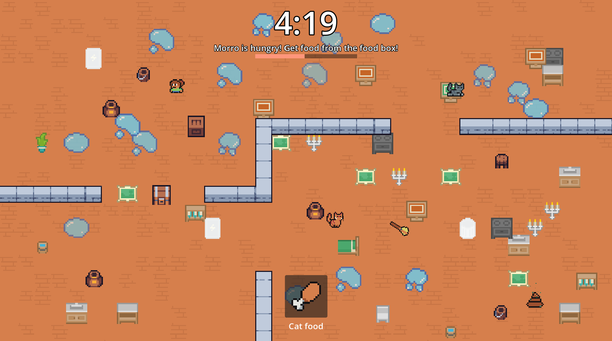
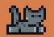
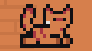

<h1 align="center">Keep Morro Happy!</h1>

<h3 align="center">A browser game about keeping your bossy cat satisfied by fulfilling his every need, while you do your house chores.</h3>

<p align="center">
  <a href="https://duc-k.itch.io/keep-morro-happy"> Play Keep Morro Happy right now! </a>
</p>

<p align="center">
  <a href="https://duc-k.itch.io/keep-morro-happy">
    
  </a>
</p>

<p align="center">
  <a href="#about">About</a> ·
  <a href="#play">Play</a> ·
  <a href="#controls">Controls</a> ·
  <a href="#features">Features</a> ·
  <a href="#run-it-in-godot">Run in Godot</a>
</p>

---

## About

Keep Morro Happy is a fast-paced, speedrun-style browser game about taking care of a bossy cat's needs while balancing everything else you have to do.

Each run, you have to complete 2 to 8 house chores before your parents get home (when the timer runs out). Your parents love Morro, so he has to stay happy the whole time, even while you're busy with your chores.

## Play

- **Play in your browser:** <a href="https://duc-k.itch.io/keep-morro-happy">https://duc-k.itch.io/keep-morro-happy</a>
- **Watch some gameplay:** <a href="https://youtu.be/k1N8LhkB4Vw">Watch the gameplay on youtube</a>

No download or installation is needed, and the game needs very little processing power. The controls use the keyboard, so a desktop or laptop is the best way to play.

## Controls

| Action                        | Key                                               |
| ----------------------------- | ------------------------------------------------- |
| Move                          | `W` `A` `S` `D` or the arrow keys                 |
| Pick up items                 | Walk over items on the floor                      |
| Interact                      | `E`                                               |
| Throw the item you're holding | `E`, when there's nothing nearby to interact with |
| Open the task list            | `Q`                                               |
| Play minigames                | Left Click

The controls are simple to learn, and the whole game can be played with one hand.

## Features

- **Easy controls:** simple to learn, and playable with one hand.
- **5 chore minigames:** each chore plays differently.
- **Inventory and item system:** pick things up, carry them, and throw them.
- **5 difficulty levels:** build the challenge up slowly.
- **Two cats:** Morro and Mango.
- **Saved settings:** global settings are saved between sessions.

<p>
  
  
</p>

## Why I made Keep Morro Happy

I made Keep Morro Happy as a gift for one of my good friends. I've already given him the game to try, and he loved it. It really shows how much a simple game can do.

Thank you to everyone who playtested the game beforehand, so I didn't have to give him the ultra difficult version. Thank you also for all the likes on the devlogs. Getting double digits on a Stardance devlog is an amazing number, and I'm still shocked by it.

## Run it in Godot

You'll need Godot **4.6 or newer**.

1. Clone this repository:

```
git clone https://github.com/Duckwastakon/Keep_Morro_Happy.git
```

2. Open Godot, choose **Import**, and select the project folder (the one that contains `project.godot`).
3. Wait a moment while Godot imports the assets the first time.
4. Press `F5` to run the game.

## Project status

The game is still in development, and more updates are coming soon.
